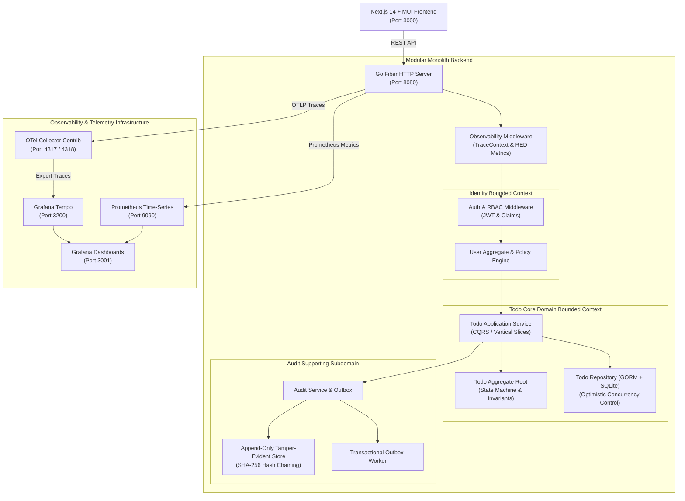

# OmniTask - Enterprise Modular Monolith & Tactical DDD Web Platform

A production-ready and deploy-ready enterprise task management platform built strictly with **Domain-Driven Design (DDD)**, **Hexagonal Clean Architecture (Ports & Adapters)**, **Vertical Slice Architecture**, and full-suite **Enterprise Observability** (OpenTelemetry, Prometheus, Grafana, Tempo, and Zerolog).

---

## 🏛 Architecture Overview



---

## 🚀 Technology Stack

| Layer | Technologies |
| :--- | :--- |
| **Backend** | Go (Golang 1.24+), GoFiber v2, GORM, SQLite (Pure Go driver, zero CGO), JWT, Bcrypt |
| **Frontend** | Next.js 14 (App Router, Standalone output), TypeScript, Material-UI (MUI v5), Emotion |
| **Observability** | OpenTelemetry SDK (gRPC OTLP), Grafana Tempo, Prometheus, Grafana, Zerolog |
| **Infra & Deploy** | Multi-stage Docker, Docker Compose, Volume isolation, Bridge networking |

---

## 🔑 Hard-Enforced Architectural Rules Implemented

1. **Strategic & Tactical Domain-Driven Design (DDD)**:
   - **Core Domain**: `Todo` Aggregate Root with strict domain invariants, Title constraints, Due Date checks, and Finite-State Machine (FSM).
   - **Generic Subdomain**: `Identity & Access` handling User aggregate, password hashing, JWT credentials, and centralized policy enforcement (PDP/PEP).
   - **Supporting Subdomain**: `Audit & Outbox` managing append-only, tamper-evident cryptographic hash chains and transactional outbox event publishing.
2. **Clean Architecture (Hexagonal Ports & Adapters)**:
   - Independent pure `domain` layer with zero framework dependencies.
   - Distinct `application` layer handling CQRS commands, queries, and DTO mappings.
   - Pluggable `infrastructure` adapters (GORM SQLite repositories, OTel exporters).
   - Isolated `server` presentation layer (GoFiber controllers & middlewares).
3. **State Machine & Invariant Transitions**:
   - `PENDING` $\rightarrow$ `IN_PROGRESS` $\rightarrow$ `COMPLETED`
   - Reopening `COMPLETED` tasks resets status back through defined workflow invariants.
   - Cancelled tasks cannot be arbitrarily marked as completed without proper reactivation.
4. **Optimistic Concurrency Control (OCC)**:
   - Version tokens on Aggregate Roots prevent dirty writes or lost updates using Compare-And-Swap (CAS) update semantics.
5. **Cryptographic Tamper-Evident Audit Logging**:
   - Every mutation is SHA-256 hash-chained to the previous audit log block (`CurrentHash = SHA256(PrevHash + Timestamp + Action + Entity + Actor + Payload)`).
   - Instant automated cryptographic integrity verification via `/api/v1/audit/verify`.
6. **Distributed Observability by Design**:
   - Every HTTP request receives an OpenTelemetry trace context and propagates `X-Trace-Id`.
   - Zerolog structured JSON logs correlate with active `trace_id`.
   - RED metrics (`http_requests_total`, `http_request_duration_seconds`) scraped by Prometheus.
   - Pre-provisioned Grafana dashboard visualizing QPS, p95 latency, status codes, and active task gauges.

---

## ⚡ Quickstart & Deployment

### 1. Launch with Docker Compose (Deploy-Ready)

Run the full stack with a single command:

```bash
docker compose up -d --build
```

### 2. Available Endpoints & Services

| Service | URL | Default Credentials | Description |
| :--- | :--- | :--- | :--- |
| **Web App** | [http://localhost:3002](http://localhost:3002) | `admin@todo.local` / `AdminPass123!` | Next.js 14 + MUI Platform |
| **Backend API** | [http://localhost:8080](http://localhost:8080) | — | Go Fiber REST API |
| **Metrics Endpoint** | [http://localhost:8080/metrics](http://localhost:8080/metrics) | — | Prometheus Metrics Exporter |
| **Grafana** | [http://localhost:3005](http://localhost:3005) | `admin` / `admin` | Dashboards for Metrics & Traces |
| **Prometheus** | [http://localhost:9092](http://localhost:9092) | — | Raw Time-Series Explorer |
| **Tempo** | [http://localhost:3205](http://localhost:3205) | — | Distributed Tracing Backend |

---

## 🧪 Local Testing & Verification

Run the test suite:

```bash
# Backend unit & invariant tests
cd backend && go test -v ./...

# Frontend production build verification
cd frontend && npm run build
```
